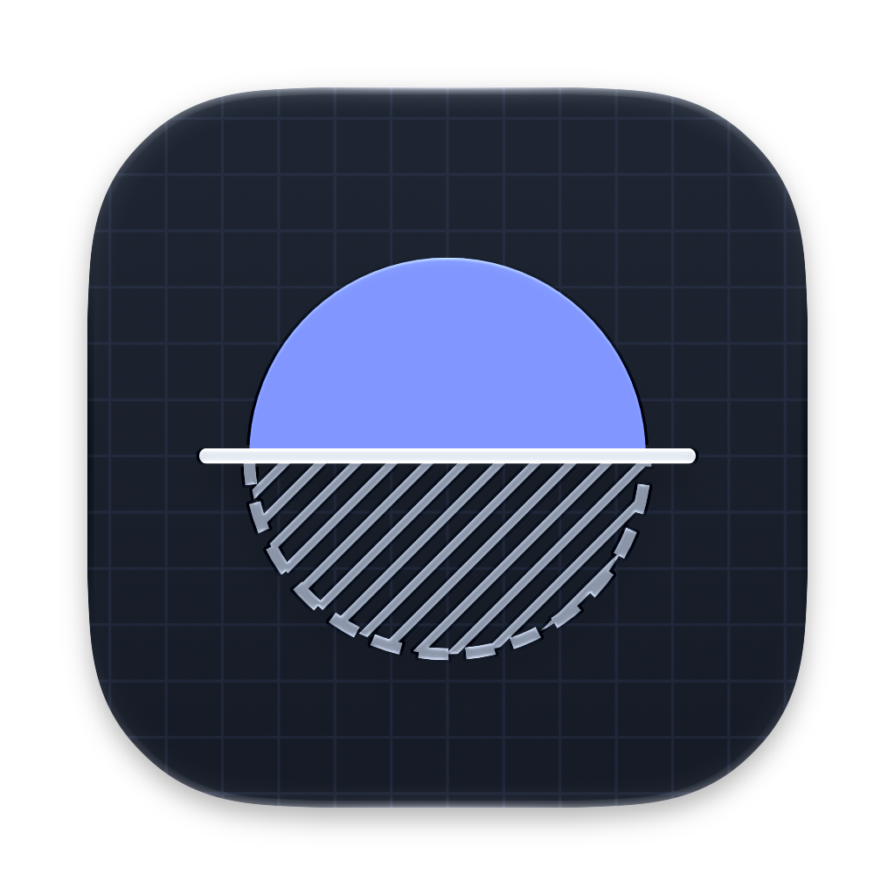
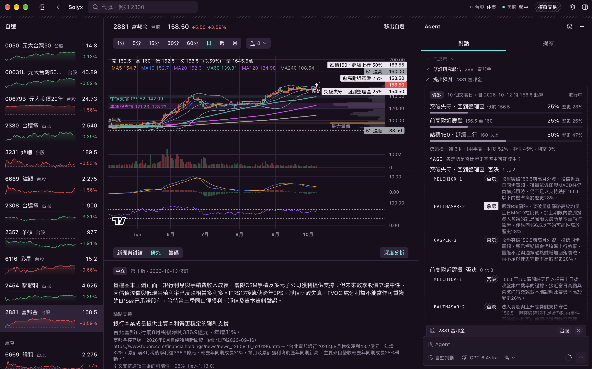

<p align="center">
  
</p>

<h1 align="center">Solyx</h1>

A personal desktop app for trading Taiwan and US stocks. An agent analyzes the market and proposes trades; nothing is sent to a broker until you confirm it yourself.

<p align="center">
  
</p>

> Solyx is in early development and ships as nightly builds. Trading runs on a paper account, since no live broker places orders yet, and market data covers Taiwan listings only. See [Status](#status).

## Features

### Workspace

- **Watchlist and positions** stay beside every page, each row with its quote and the session's line.
- **Charts** run from one-minute to monthly bars and follow the session live, with moving averages, Bollinger bands, VWAP, MACD, RSI, KD, volume ratio and relative strength against the market's index.
- **Levels** are marked from the bars themselves: support zones along the quarter and half-year lines, the volume profile, the 52-week range and the session's levels. The agent cites the same levels the chart draws.
- **Investor flows** (籌碼) show who trades a Taiwan listing: foreign investors' and investment trusts' net buying and margin balances, as chart panes and a tab of their own.
- **Overview** gathers the news of what you watch, heat maps of your listings and of Taiwan's sectors, and a calendar of filings, ex-dividend days, shareholders' meetings, market closures and economic releases with their figures.

### Agent

- **Talks about what is on screen.** A conversation carries the listing you are looking at; name others with `@` and call a skill with `/`.
- **Cites figures instead of working them out.** Its tools read candles, indicators, fundamentals, investor flows, economic figures, the calendar, news and your account, and the app computes growth, margins and multiples so the model quotes them.
- **Runs its own analysis.** Scripts it writes run in a sandbox that reads market data and the account and reaches nothing else.
- **Searches and reads the web** through Firecrawl, Exa or Tavily.
- **Remembers across conversations** what it learns of how you trade, in memories you can read, edit and forget.
- **Works on a schedule.** A task sends it a message every so often, at a time of day on the days a market trades, or once something the app watches has changed, and runs go on while the app sits in the menu bar.
- **Takes your extensions.** Add playbooks as skills, standing instructions in `AGENTS.md` and tools from MCP servers in `mcp.json`, each tool set to off, ask or auto.
- **Asks before it acts.** Each conversation is set to ask, auto or bypass. In auto, a call runs unasked only when its own check passes, as when a decisions model scores every risk of a shell command unlikely. No mode lets the agent confirm an order.
- **Runs on your model.** Use an API key for a model provider or sign in with ChatGPT, and pick the model and thinking level per conversation.

### Research and forecasts

- **Reports** hold a view of a listing over quarters: its drivers, risks, what would prove it wrong and the event ahead. Every revision is kept, and each stance is measured against the market's index.
- **Claims carry their source's own words.** A quote must stand in something the conversation actually read, and a decisions model checks that it says what the claim asserts; a report that fails either is refused.
- **Forecasts are scored.** A forecast splits the horizon's close into price bands with a probability each, is frozen once made, and is judged against what the price did and against how often the listing's own history lands in each band.
- **MAGI** puts a forecast's scenarios and an order proposal to a vote: three units, each a persona on a model you pick, judge alone, and two votes carry a motion. A carried order still waits for you.
- **Themes** watch a topic that could reach what you hold over quarters, with a daily news search and the signposts that would mark a development.

### Orders

- **One road to an order:** the agent proposes, risk checks run, you confirm, the checks run again, and only then does the order reach the broker.
- **Market rules are built in:** tick sizes, board and odd lots, and trading sessions for each market.
- **A failed submission is never retried,** since the broker may have accepted the order anyway.

### News

- **Sources:** the material information Taiwan companies file, the share transfers their insiders declare, PTT's Stock board, and news outlets' articles and Threads and X posts through your web search key.
- **Stories, not headlines:** reprints and rewordings of one event are grouped into a story, and a decisions model reads who speaks in each and which way it leans.

### App

- Stays in the menu bar or system tray, where its menu lists the proposals and calls waiting for you.
- English and Traditional Chinese, light and dark, with palettes you can edit. Red and green follow each market's convention for a rise.
- Settings live in `~/.solyx/config.json`, which you may edit by hand and the app applies without a restart.
- Updates itself. Crash reports are sent only once you agree, and traces and logs go only to an endpoint you name.

## What it runs on

Every key is yours and is saved encrypted on your computer. Market data and a model are enough to start; the rest add to what the agent can do.

| For                                               | Source                                                  | You bring                                 |
| ------------------------------------------------- | ------------------------------------------------------- | ----------------------------------------- |
| Taiwan quotes and candles                         | Fugle, or Fubon                                         | A Fugle API key, or Fubon's SDK and login |
| Fundamentals, dividends and investor flows        | FinMind                                                 | Nothing; a token raises the limit         |
| Exchange lists, filings and insider transfers     | TWSE's and TPEx's open data                             | Nothing                                   |
| Funds' net asset values and costs                 | SITCA's open data                                       | Nothing                                   |
| Economic releases and their figures               | Taiwan's statistics portal and DGBAS                    | Nothing                                   |
| The agent's model                                 | A model provider of your choice                         | An API key, or a ChatGPT sign-in          |
| Web search and news outlets                       | Firecrawl, Exa or Tavily                                | An API key                                |
| Reading claims, news and commands (decisions)     | TypeSafe, Cloudflare Workers AI or OpenAI               | An API key                                |
| Search by meaning and grouping stories (embedder) | OpenAI, or a model on your computer (Ollama, LM Studio) | An API key, or nothing                    |

SITCA's data is used under the [Open Government Data License, version 1.0](https://data.gov.tw/license), as the Securities Investment Trust & Consulting Association of the R.O.C. releases it on Taiwan's government open data platform.

## Principles

- **Local-first:** broker certificates, credentials and API keys stay on your machine. There is no relay server.
- **Bring your own key:** market data providers and LLMs run on your own accounts and keys.
- **A human confirms every order:** the agent can only propose. Risk checks run again right before an order goes to the broker.
- **Paper by default:** live trading stays off until you explicitly turn it on.

## Status

- **One live broker.** Besides the paper account, Solyx trades only a Fubon Securities account, and buys there need a settlement account at Taipei Fubon Bank or LINE Bank.
- **Taiwan market data only.** The app follows the US session and its rules, but no US data source is wired up.

## Install

Nightly builds for macOS (`.dmg`) and Windows (`.exe`) are on the [releases page](https://github.com/Chia1104/solyx/releases). The macOS app is ad-hoc signed and the Windows installer unsigned, so the system warns before the first launch. A nightly installs as Solyx Nightly and keeps its own data.

## Development

Requires [Vite+](https://viteplus.dev/) (`vp`) and Node.js 26 or later.

```bash
vp install                 # install dependencies
vp run dev:desktop         # start the desktop app in development mode
vp run dev:website         # start the website in development mode
vp run deploy:website      # build the website and deploy it with Void
vp run ready               # check, test and build
```

Architecture and repository rules live in [`AGENTS.md`](./AGENTS.md).

## License

Copyright (C) 2026 Chia1104

Solyx is free software under the [GNU Affero General Public License, version 3 or later](./LICENSE).

## Disclaimer

This software is not investment advice. You alone are responsible for any gains or losses from trades made with it. It is provided as is, without warranty of any kind.
